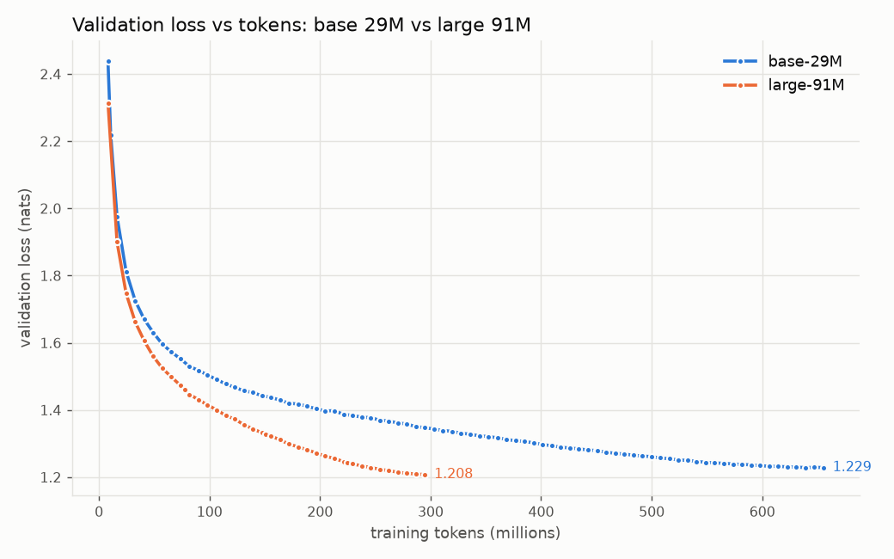
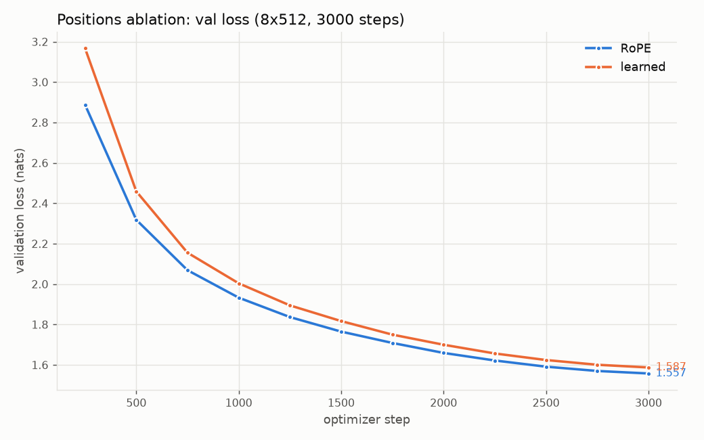
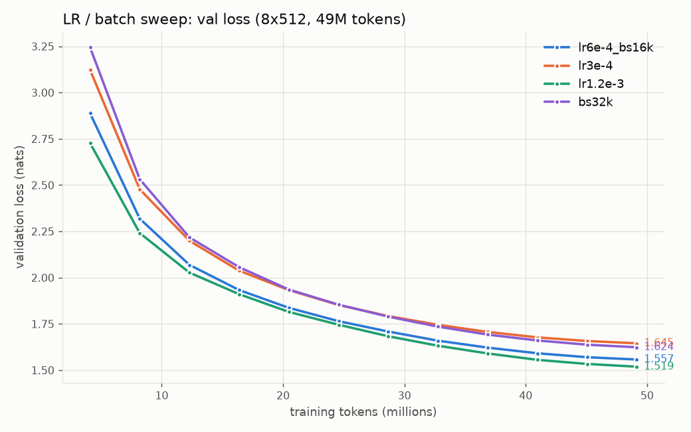

# Evaluation report (PLAN Day 26)

Regenerate with `timeout 1200 .venv/bin/python scripts/make_eval.py` (≈ 2 min on the RTX 5050). Perplexity is measured by the script; follow rates and ablation/sweep tables are copied from the docs their own scripts wrote (linked).

## 1. Perplexity on TinyStories validation

200 × 32 windows of 256 tokens (1,638,400 tokens, seed 1234), identical for every row, bf16 autocast. Tokenizer: own 8192-token byte-level BPE, so ppl is per BPE token (≈ 4 bytes).

| model | checkpoint | step | params | weights MB | val loss | ppl | Δ vs base | notes |
|---|---|---|---|---|---|---|---|---|
| base-29M | `ckpt/base` | 40000 | 29.4M | 112 | 1.2410 | 3.459 | +0.0000 | 8×512 pretrain, 655M tokens |
| base-29M int8 | `ckpt/base` | 40000 | 29.4M | 44 | 1.2412 | 3.460 | +0.0001 | weight-only int8 of base |
| large-91M | `ckpt/large` | 18000 | 91.3M | 348 | 1.2192 | 3.384 | -0.0218 | 12×768 pretrain, 295M tokens |
| large-91M int8 | `ckpt/large` | 18000 | 91.3M | 111 | 1.2193 | 3.385 | -0.0217 | weight-only int8 of large |
| instruct-v4 (29M) | `ckpt/instruct_v4` | 2000 | 29.4M | 112 | 1.2607 | 3.528 | +0.0196 | prompt fine-tune of base |
| chat-v3 (91M) | `ckpt/chat_large_v3` | 1000 | 91.3M | 348 | 1.2429 | 3.466 | +0.0019 | chat fine-tune of large |

Fine-tuned models score worse on plain stories because they were trained on a different format (prompted stories / chat turns); that is expected and not a regression.

Training curves: [base](figures/loss.png), [large](figures/large_loss.png). Detail: [large_vs_base.md](large_vs_base.md).

## 2. Prompt following (200 held-out prompts, T=0.8 top-p=0.95)

A sample "follows" if it contains all 3 requested words, or starts with the requested sentence.

| model | follows | source |
|---|---|---|
| base-29M, no fine-tune | 0.0% | [instruct_eval_base.md](instruct_eval_base.md) |
| instruct v1 | 16.5% | [instruct_eval_ft.md](instruct_eval_ft.md) |
| instruct v2 | 15.0% | [instruct_eval_ft_v2.md](instruct_eval_ft_v2.md) |
| instruct v3 | 16.5% | [instruct_eval_v3_on_anyfix.md](instruct_eval_v3_on_anyfix.md) |
| instruct v4 (word tokens ×5) | 25.0% | [instruct_eval_v4_on_anyfix.md](instruct_eval_v4_on_anyfix.md) |
| large-91M, no fine-tune | 0.0% | [instruct_eval_large_base.md](instruct_eval_large_base.md) |
| chat v1 (large) | 15.5% | [chat_eval_large.md](chat_eval_large.md) |
| chat v2 (large, ×5) | 14.0% | [chat_eval_large_v2.md](chat_eval_large_v2.md) |
| chat v3 (large, always 3 words) | 20.5% | [chat_finetune.md](chat_finetune.md) |

Details and per-kind splits: [chat_finetune.md](chat_finetune.md).

## 3. Ablations at a fixed 49M-token budget (8×512 model)

Positions ([abl_pos_table.md](abl_pos_table.md)):

| run | steps | tokens (M) | final val loss | val ppl | best val loss | tok/s |
|-----|------:|-----------:|---------------:|--------:|--------------:|------:|
| RoPE | 3000 | 49.2 | 1.5573 | 4.75 | 1.5573 | 86.6k |
| learned | 3000 | 49.2 | 1.5871 | 4.89 | 1.5871 | 90.1k |

Learning rate / batch ([sweep_table.md](sweep_table.md)):

| run | steps | tokens (M) | final val loss | val ppl | best val loss | tok/s |
|-----|------:|-----------:|---------------:|--------:|--------------:|------:|
| lr6e-4_bs16k | 3000 | 49.2 | 1.5573 | 4.75 | 1.5573 | 86.6k |
| lr3e-4 | 3000 | 49.2 | 1.6448 | 5.18 | 1.6448 | 87.2k |
| lr1.2e-3 | 3000 | 49.2 | 1.5186 | 4.57 | 1.5186 | 87.1k |
| bs32k | 1500 | 49.2 | 1.6235 | 5.07 | 1.6235 | 87.6k |

## 4. Inference

KV cache, batch and dtype speed: [infer_bench.md](infer_bench.md); int8: [infer_bench_int8.md](infer_bench_int8.md). Int8 costs ≤ +0.0002 val loss and shrinks weights ~3×, but is ~25% slower (dequantised per call, no int8 kernel).

## 5. Samples

- Base sample suite: [suite_step40000.md](../samples/suite_step40000.md)
- Large sample suite: [large.md](../samples/large.md)
- Scripted chat session (chat-v3): [chat_session.md](../samples/chat_session.md)

## 6. What helped (and what didn't)

- **Model size**: 91M beats 29M at every equal token count (1.208 vs 1.348 at 295M tokens) and wins on final val loss despite 2.2× fewer tokens. The largest single gain.
- **Higher LR**: 1.2e-3 beat 6e-4 by 0.039 at 49M tokens; 3e-4 was clearly worse. A bigger batch (32k tokens/step) at the same token budget was worse (fewer updates).
- **RoPE** over learned positions: −0.030 val loss at 49M tokens.
- **Loss weight ×5 on requested-word tokens** was the only fine-tune change that moved prompt following a lot (instruct v3 16.5% → v4 25.0%). More epochs or more rows of the same data did not help; val loss plateaus within ~100 steps.
- **Chat format on the large model** reached 20.5% follow, below the 29M instruct v4 (25%): bigger base did not transfer to instruction following with this small synthetic data.
- **KV cache**: 1.6–3× faster at batch 1, ~22–25× at batch 32; **int8** is near-lossless but slower.
