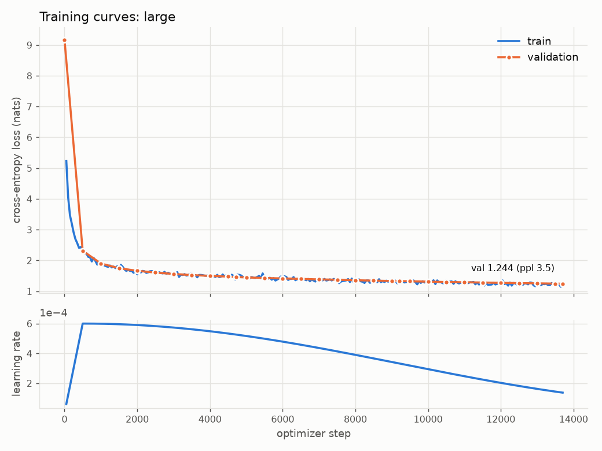
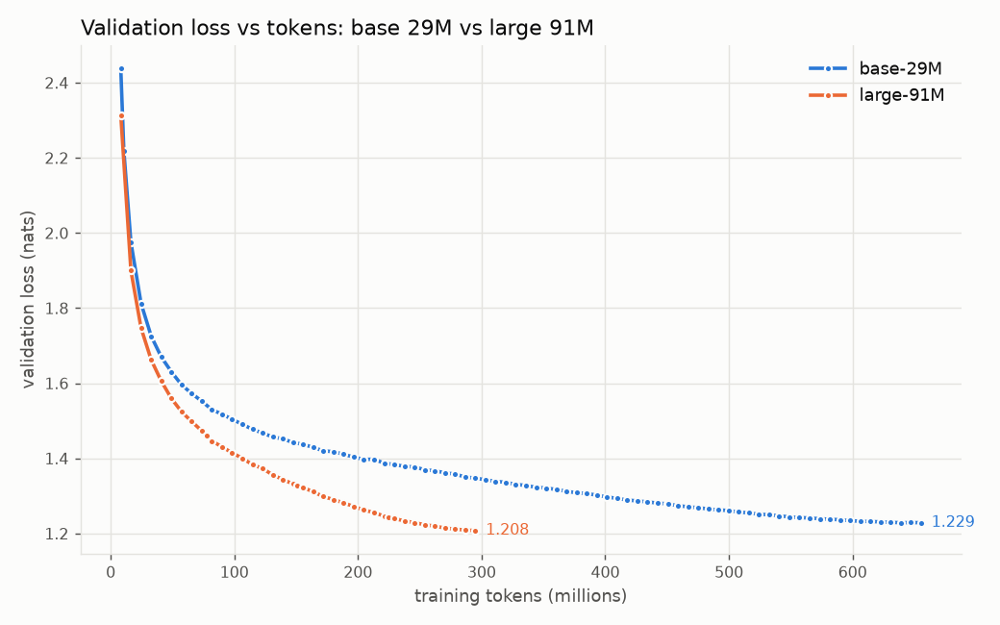
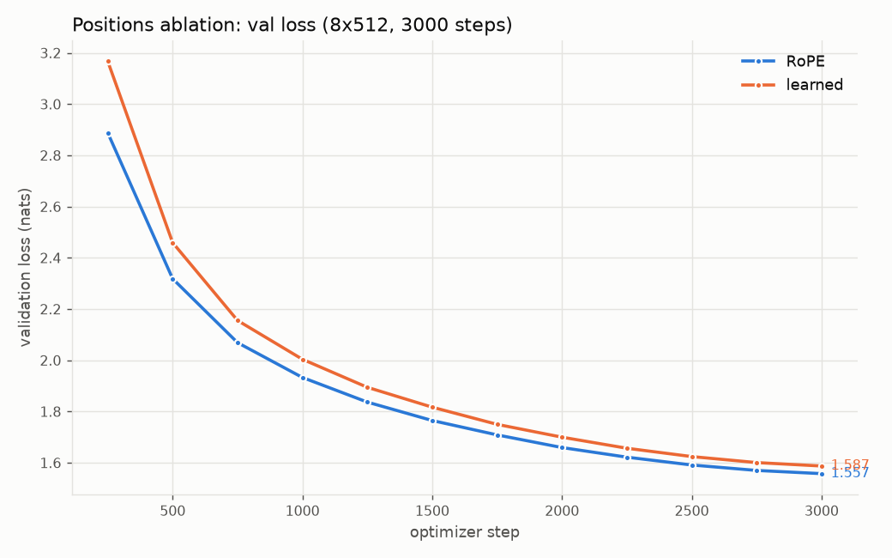
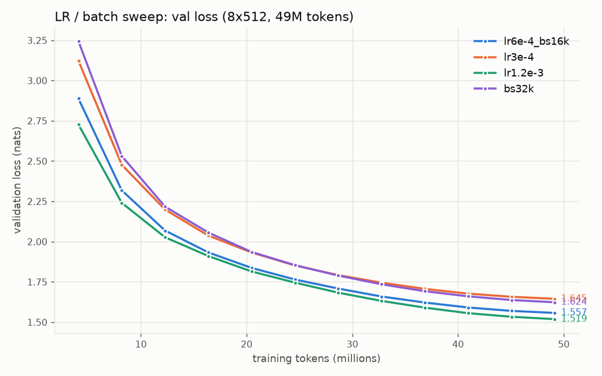

# tiny-llm — final report (PLAN Day 29, 2026-11-10)

GPT-style language models written from scratch in PyTorch (own BPE tokenizer, transformer, training loop,
sampling, KV cache, int8 quantization, chat fine-tune) and trained on a 700 MiB subset of TinyStories on one
RTX 5050 Laptop GPU (8 GB, sessions of ≤ 45 min). Two pretrained models: **base-29M** (8×512) and **large-91M**
(12×768), plus an instruction fine-tune (29M) and a chat fine-tune (91M). All numbers below come from scripts in
`scripts/`; the regenerable evaluation tables are in [EVAL.md](EVAL.md).

## 0. Results at a glance
Validation: the same 200 × 32 windows of 256 tokens for every row (`scripts/make_eval.py`), ppl per BPE token (≈ 4.1 bytes).

| model | params | trained on | val loss | ppl | weights |
|---|---|---|---|---|---|
| base-29M | 29.4M | 655M tokens (40k steps) | 1.2410 | 3.459 | 112 MB |
| base-29M int8 | 29.4M | – | 1.2412 | 3.460 | 44 MB |
| large-91M | 91.3M | 295M tokens (18k steps) | **1.2192** | **3.384** | 348 MB |
| large-91M int8 | 91.3M | – | 1.2193 | 3.385 | 111 MB |
| instruct-v4 (from base) | 29.4M | +2000 steps | 1.2607 | 3.528 | 112 MB |
| chat-v3 (from large) | 91.3M | +1000 steps | 1.2429 | 3.466 | 348 MB |

Prompt following on 200 held-out prompts: instruct-v4 **25.0%**, chat-v3 20.5%, either base model 0%.
KV cache: 1.6–3× faster at batch 1 and 22–25× at batch 32 (fp32, greedy output identical).

## 1. Data and tokenizer
- TinyStories V2 (GPT-4) text, CDLA-Sharing-1.0: full validation file (27,630 stories) and the
  first 700 MiB of train (895,926 stories), cut at a story boundary.
- Own byte-level BPE (GPT-2 pre-tokenisation regex), vocab 8192: 256 bytes + 7,935 merges +
  `<|endoftext|>` (id 8191), trained on the first 200 MiB of train.
- 4.14 UTF-8 bytes per token; 176.7M train tokens and 5.4M val tokens, stored as uint16 memmaps.
- Checks: `scripts/check_tokenizer.py` (full-val round-trip, the .bin equals a fresh encoding,
  EOT count == story count) and `scripts/check_tokens.py` (file sizes vs meta, id range,
  random slices decode to readable text).

## 2. Model
| | |
|---|---|
| layers × d_model × heads | 8 × 512 × 8 (head dim 64) |
| context | 256 tokens |
| positions | RoPE (learned positions available as a switch) |
| block | pre-LayerNorm, causal self-attention (SDPA), GELU MLP 4×, residuals |
| embeddings | tied input/output |
| parameters | 29.4M |

The large model uses the same code with 12 layers × 768 × 12 heads (91.3M parameters), see section 3.1.

Attention has two paths: a readable `manual` one (QKᵀ/√d, causal mask, softmax, ·V) and PyTorch SDPA
(`is_causal=True`, used for training). `scripts/check_attention.py` checks them against each other on the trained
model and real val text: the fp32 logits agree to 4.8e-5 and the val loss is identical (1.355887). Changing
tokens ≥ t leaves the logits < t bit-identical, the gradient of a logit w.r.t. later input embeddings is exactly 0,
and the KV-cache chunk path matches the full forward. SDPA trains at 70.7k vs 51.2k tok/s (uncompiled, batch 32)
and needs 3.0 vs 3.7 GB.

`scripts/check_model.py` checks the full-size model (both position types) on real val text: parameter count equals
the closed form (12d² + 4d per block, V·d tied embedding, 2d final LN, +T·d for learned positions = 29,377,536 for
RoPE, 29,508,608 learned); init stds are 0.02 (0.02/√16 for residual projections); the init loss is 9.07–9.08 against
ln 8192 = 9.011 (the extra ~0.07 is the logit variance 0.45²/2; the tied-embedding "self-token" logit is only +1.1–1.2
because the embedding is ~10% of the residual stream by the last layer); the residual-stream std grows smoothly
0.02 → 0.19 over 8 layers; causality holds bit-exactly; all parameters get finite non-zero grads; and 20 AdamW steps
on one batch take the loss from 9.07 to 5.29.

`scripts/check_rope.py` checks the rotary embeddings at head_dim 64. `apply_rope` equals an fp64 complex-number
reference (x₂ᵢ + j·x₂ᵢ₊₁ times e^(j·pos·θᵢ), θᵢ = 10000^(−2i/64)) to 3e-5. Over all 256×256 position pairs the score
⟨R_m q, R_n k⟩ depends only on m − n and equals the closed form Σ Re(qᵢ k̄ᵢ e^(j(m−n)θᵢ)) (relative error 1.5e-6).
On the trained model the real q·k scores of layers 0 and 7 are unchanged (relative error ≤ 5e-6) when every position
is shifted by 1, 37 or 256. The whole model's val loss is identical as well (1.35589, logits within 7e-5). So the
RoPE model only sees relative positions and could be run at any offset. The same weights with learned positions
change by up to 11 logits for a 1-step shift. Causality is still bit-exact, shifted or not.

## 3. Training
bf16 autocast, AdamW (β = 0.9/0.95, weight decay 0.1 on matrices only), grad clip 1.0,
micro-batch 32 × grad-accum 2 × 256 tokens = 16,384 tokens/step, LR 6e-4 with 500 warmup steps
and cosine decay to 6e-5 at 40,000 steps (655M tokens ≈ 3.7 epochs of the subset).
`torch.compile` raised throughput from 66k to ~88.7k tok/s; peak VRAM 2.24 GB.
Checkpoints include the optimizer, RNG and data state, so resume is exact (tested).

| step | val loss | val ppl |
|---|---|---|
| 651 | 2.219 | 9.2 |
| 14,030 | 1.384 | 4.0 |
| 27,495 | 1.279 | 3.59 |
| 40,000 | 1.229 | 3.42 |

### 3.1 Large model (91M)
`configs/large.json`: 12 × 768 × 12 heads, otherwise identical (RoPE, block 256, 16,384 tokens/step, lr 6e-4 →
6e-5 cosine, warmup 500, bf16, `torch.compile`). Candidates were benchmarked in [bench_large.md](bench_large.md);
this one fits without gradient checkpointing (4.96 GB peak, 31k tok/s). Gradient checkpointing is implemented
(`model.grad_checkpoint`, same loss/grads in `tests/test_grad_ckpt.py`) but costs speed, so it is off.
18,000 steps (295M tokens) took four resumed ≤ 42-min sessions; the loss curve is continuous across resumes.

At equal training tokens the large model is always ahead, and it wins on final loss with 2.2× fewer tokens
([large_vs_base.md](large_vs_base.md)):

| tokens | base-29M | large-91M |
|---|---|---|
| 82M | 1.529 | 1.446 |
| 164M | 1.429 | 1.311 |
| 295M | 1.348 | 1.208 |
| final (200×32 windows) | 1.2410 (655M tok) | **1.2192** (295M tok) |

## 4. Samples
See [suite_step40000.md](../samples/suite_step40000.md) (6 prompts × 4 decoding settings, fixed seeds). 23/24 samples
end on their own with `<|endoftext|>`; repeated-4-gram fraction 0.010–0.049. Greedy example:

> Once upon a time, there was a little girl named Lily. She had a big, red ball that she loved to
> play with. One day, she went to the park with her mom and took her ball with her. […] After
> playing, Lily and Tim became good friends. They learned that sharing made them happy. The moral
> of the story is to always share with others and be kind.

The large model's suite ([large.md](../samples/large.md)) ends all 24 samples with EOT; repetition is similar
(mean rep4 0.015–0.044 vs 0.010–0.049). Both write fluent, simple stories; the large one keeps characters and
objects consistent a bit more often, but the difference is small to the eye — the loss gap (0.02 nats) is small too.
A scripted chat session with chat-v3 is in [chat_session.md](../samples/chat_session.md).

## 5. Fine-tunes

### 5.1 Instruction fine-tune (29M)
Prompts are made from our own stories ("uses the words …" / "begins with …"), and the loss is on the
story only. Measured with `scripts/eval_instruct.py` on 200 held-out prompts (T=0.8, top-p 0.95):

| model | follows prompt |
|---|---|
| base (step 40,000) | 0.0% (`instruct_eval_base.md`) |
| fine-tuned v1 (33k rows, 1000 steps ≈ 2 epochs, lr 1e-4) | 16.5% overall: "begins with" 88.6%, "uses the words" 1.2% (`instruct_eval_ft.md`) |
| fine-tuned v2 (132k rows, 2000 steps ≈ 1 epoch, lr 5e-5) | 15.0% overall: "begins with" 82.9%, "uses the words" 0.6% (`instruct_eval_ft_v2.md`) |

Partial credit on "uses the words" prompts (share of requested words that appear): base 4.8%, v1 23.6%, v2 22.8%.

The fine-tuned model reliably writes a story after `Story:` and copies a given opening sentence. It
rarely uses three requested words: it tends to write a typical story and ignore them. Val loss (story
tokens of held-out rows) fell from 1.227 to 1.103 by step 100, then rose slightly to 1.118 at step 1000,
while train loss fell to 0.92. One epoch is 516 steps, so the rise starts inside the first epoch. The
quick gain is the prompt format, and after that the model fits these 33k stories. Next to try: a few
times more rows at ≤ 1 epoch and fewer steps, and judging "uses the words" by partial credit too.

v2 tried exactly that: 4× the rows, about 1 epoch, half the LR. Val loss improved (1.082 vs 1.103 at best,
still falling at the end), but prompt-following did not; the differences from v1 are within sampling noise on
200 prompts. `scripts/prompt_sensitivity.py` shows why. It scores each held-out story after its own prompt
and after another row's prompt (story loss, nats/token, 200 rows per kind):

| model | "words": swapped − own | "begins": swapped − own |
|---|---|---|
| base | +0.001 | +0.061 |
| v1 | +0.010 | +0.210 |
| v2 | +0.010 | +0.215 |

The fine-tuned models use a given first sentence heavily, but barely use the word list: wrong words cost
only 0.01 nats/token. Lower story loss came from better story modelling, not from reading the
prompt. With 3 random content words per ~200-token story, the words contribute little to the loss, so
there is little gradient pushing the model to attend to them. Ideas for the next pass: up-weight the
loss on the requested-word tokens, use fewer, more salient words (nouns that occur more than once), or
start with 1-word prompts and build up to 3.

**v3 (salient words) and a prompt bug.** While building v3 I found a bug in the word picker: the regex
`[a-z]{4,}` also matched the lowercase tail of capitalised words ("Suddenly" → "uddenly", "Tommy" → "ommy"),
so about 9% of the v1/v2 "words" prompts asked for a fragment no story contains. That caps the follow rate.
Fixed with word boundaries, plus a regression test that every words prompt is satisfiable by its own story;
274 of the 818 held-out prompts change. v3 = 132k rows where the 3 words are drawn from the story's
**salient** words (content words occurring ≥ 2×, i.e. characters/objects/places), same recipe as v2
(`configs/instruct_v3.json`, lr 5e-5, 2000 steps, 6.5 min). Val loss 1.072 (v2 1.082, not comparable: different rows).

| eval prompts (200 held-out) | model | follows | begins | words | words partial |
|---|---|---|---|---|---|
| fixed "any" words (`data/instruct_anyfix`) | v2 | 15.0% | 82.9% | 0.6% | 22.8% |
| | v3 | 16.5% | 82.9% | 2.4% | 30.9% |
| salient words (`data/instruct_v3`) | v2 | 18.5% | 87.2% | 1.9% | 27.1% |
| | v3 | 20.0% | 89.7% | 3.1% | 36.9% |

Prompt sensitivity ("words" gap, swapped − own, nats/token): on the old prompts v2 +0.010 → v3 +0.017; on
salient prompts v2 +0.015 → v3 +0.033. "Begins" gaps are unchanged (~+0.21). So salient words roughly double
the model's use of the word list and raise partial credit by 8–10 points, but using all three words is still
rare (~3%). The word list is still a weak signal next to the story-modelling loss; the remaining lever is to
up-weight the loss on the requested-word tokens (or 1-word prompts first). Files: `instruct_eval_v{2,3}_on_{anyfix,v3}.md`.

**v4 (up-weighted word tokens).** Same 132k rows and recipe as v3; only the loss changes. `scripts/mark_words.py`
marks every target token that is part of a whole-word, case-insensitive occurrence of a requested word (4.0% of
target tokens; every words row has at least one mark). Those positions get weight 5, everything else 1, and the
loss is the weighted mean over the story targets (`train.train_mask_file`, `train.mask_loss_weight`). The marked tokens
are then ~17% of the loss mass instead of 4%. Unweighted val loss 1.082 (v3 1.072): it costs a little story modelling.

| eval prompts (200 held-out) | model | follows | begins | words | words partial |
|---|---|---|---|---|---|
| fixed "any" words | v3 | 16.5% | 82.9% | 2.4% | 30.9% |
| | **v4** | **25.0%** | 88.6% | 11.5% | 52.3% |
| salient words | v3 | 20.0% | 89.7% | 3.1% | 36.9% |
| | **v4** | **39.0%** | 87.2% | 27.3% | 62.7% |

Words sensitivity gap: salient +0.033 → +0.063, fixed-any +0.017 → +0.039 nats/token; begins unchanged (~+0.20–0.21).
This is the largest single gain of the fine-tune work: the model wasn't failing to *understand* the list, the
signal was just drowned out by ~200 other story tokens per row. Stories still end with EOT (192–196/200) and repetition
is unchanged (rep4 0.022). Files: `instruct_eval_v4_on_{anyfix,v3}.md`.

### 5.2 Chat fine-tune (91M) and `chat.py`
Template (`tinyllm/chat.py`): plain text `User: …\nAssistant: …<|endoftext|>` on the existing 8192 vocab, loss only
on the reply tokens and their EOT. Data built from our own stories (`scripts/build_chat.py`): word requests,
"begins with"/"continue this", free story requests and fixed small-talk turns, 1–3 turns per 256-token row.
Fine-tunes of large-91M ([chat_finetune.md](chat_finetune.md)), same 200 prompts as instruct-v4, wrapped in the template:

| model | follows | begins | words | words present |
|---|---|---|---|---|
| chat v1 (mixed 1–3 words) | 15.5% | 80.0% | 1.8% | 20.2% |
| chat v2 (+ word tokens ×5) | 14.0% | 65.7% | 3.0% | 26.5% |
| **chat v3** (always 3 words, ×5) | **20.5%** | 68.6% | 10.3% | 42.6% |
| instruct-v4 (29M, reference) | 25.0% | 88.6% | 11.5% | 52.3% |

The planned check (≥ 25%) was not met; v3 was accepted. The bigger base did not help instruction following
here: the data are small and synthetic, val loss flattens after ~100 steps, and the chat set has fewer word rows
(34k vs 132k). `scripts/chat.py` is an interactive multi-turn CLI (KV cache, T/top-k/top-p flags, history
truncated to the 256-token context, `--max-turns` for scripted runs; driven by `tests/test_chat_cli.py`).

## 6. Inference speed and int8
Greedy, 240 new tokens, median of 3 ([infer_bench.md](infer_bench.md), `scripts/infer_bench.py`):

| model | batch | no cache tok/s | cache tok/s | speedup |
|---|---|---|---|---|
| base-29M fp32 | 1 | 354 | 559 | 1.58× |
| base-29M fp32 | 32 | 527 | 11,425 | 21.7× |
| base-29M bf16 | 32 | 1,731 | 13,034 | 7.5× |
| large-91M fp32 | 1 | 122 | 375 | 3.07× |
| large-91M fp32 | 32 | 179 | 4,458 | 24.8× |
| large-91M bf16 | 32 | 617 | 6,948 | 11.3× |

In fp32 the cached greedy output equals the uncached one for every model and batch. In bf16 it can diverge after
a near-tie argmax (different matmul shapes round differently); harmless for sampling. Batch 1 is launch-bound, so
bf16 gives nothing there.

Int8 weight-only, per-output-channel symmetric, own code (`tinyllm/quant.py`, [infer_bench_int8.md](infer_bench_int8.md)):
Δ val loss +0.0001 (base) / +0.0002 (large), weights 2.5–3.1× smaller, but ~20–27% slower because each Linear
dequantizes to bf16 on every call (no int8 GEMM kernel). It is a memory win, not a speed win.

## 7. What changed results
Ranked by effect:
1. **Model size**: 91M vs 29M, −0.14 nats at 295M tokens and −0.022 on the final checkpoints despite 2.2× fewer tokens.
2. **Loss weight ×5 on requested-word tokens** (fine-tune): follow rate 16.5% → 25.0% (fixed prompts) and 20% → 39% (salient prompts).
3. **Learning rate**: 1.2e-3 beat 6e-4 by 0.039 at 49M tokens; 3e-4 was 0.088 worse. A 2× batch at equal tokens was worse.
4. **RoPE** over learned positions: −0.030 at 49M tokens (bigger gap early).
5. **Fixing the word-picker bug** and using salient words: +1.5–3.5 points follow, partial credit +8–10 points.
6. **Speed (more tokens per session)**: `torch.compile` +31% throughput; KV cache up to 25× at generation time.

Did not help: more epochs or more rows of the same fine-tune data (val plateaus by ~100 steps); a larger base for
the chat fine-tune; int8 for speed.

### 7.1 Positions ablation
Same 8×512 model and 16k-token batch as the main run, 3000 steps (49.2M tokens) each with its own
warmup 300 + cosine schedule (`scripts/run_abl_pos.sh`, Day 6).

| positions | final val loss | val ppl | tok/s |
|---|---|---|---|
| RoPE | **1.557** | 4.75 | 86.6k* |
| learned | 1.587 | 4.89 | 90.1k |

RoPE is ahead at every eval. The gap is largest early (0.28 nats at step 250, 0.14 at 500) and narrows to
0.030 at the end, so RoPE mostly speeds up early learning. One seed per arm, so seed-to-seed spread is not
measured. But the gap is consistent across all 12 evals (same fixed 40 val windows). *RoPE's tok/s is lower partly because
CPU jobs ran alongside it; the extra rotation costs a few % at most.

### 7.2 LR / batch sweep
Equal 49.2M-token budget, 8×512 model, each run with its own warmup + cosine (to lr/10)
(`scripts/run_sweep.sh`, Day 6). The baseline is the positions-ablation RoPE run.

| run | lr | tokens/step | steps | final val loss | ppl |
|---|---|---|---|---|---|
| baseline | 6e-4 | 16k | 3000 | 1.557 | 4.75 |
| lr3e-4 | 3e-4 | 16k | 3000 | 1.645 | 5.18 |
| lr1.2e-3 | 1.2e-3 | 16k | 3000 | **1.519** | 4.57 |
| bs32k | 6e-4 | 32k | 1500 | 1.624 | 5.07 |

- At this short budget, a higher LR is better: going 3e-4 → 6e-4 → 1.2e-3 gives 1.645 → 1.557 → 1.519. It is
  still improving at 1.2e-3, and training stayed stable (val fell at every eval; grad norm ≤ 0.53 after step 500), so the best LR is ≥ 1.2e-3.
- Doubling the batch at the same LR and token count is worse (1.624 vs 1.557): half as many optimizer steps.
  It would likely need a higher LR to catch up. With 49M tokens we are well below the critical batch size.
- Caveat: these are 3000-step runs. The main run (40k steps, lr 6e-4) might also have gained from a higher
  LR, but that wasn't tested at full length. One seed per run.

## 8. Limitations and what's next
- One seed per run; differences under ~0.01 nats (and ±3 points of follow rate on 200 prompts) are within noise.
- 256-token context: in `chat.py` a full story fills it, so older turns are usually dropped (visible in
  [chat_session.md](../samples/chat_session.md)); multi-turn memory is effectively one turn. A longer context
  (RoPE allows it) would fix that.
- Only a 700 MiB TinyStories subset (disk cap 12 GB); the base model saw each story ~3.7 times, the large ~1.7 times.
  The large model was still improving at its final step, so a longer run (or a higher LR, section 7.2) would likely help.
- Instruction following stays low (≤ 25% for all three words); the synthetic prompts are a narrow task.
- Int8 needs a fused kernel to be faster; the KV cache is rebuilt from the last 128 tokens past 256.
