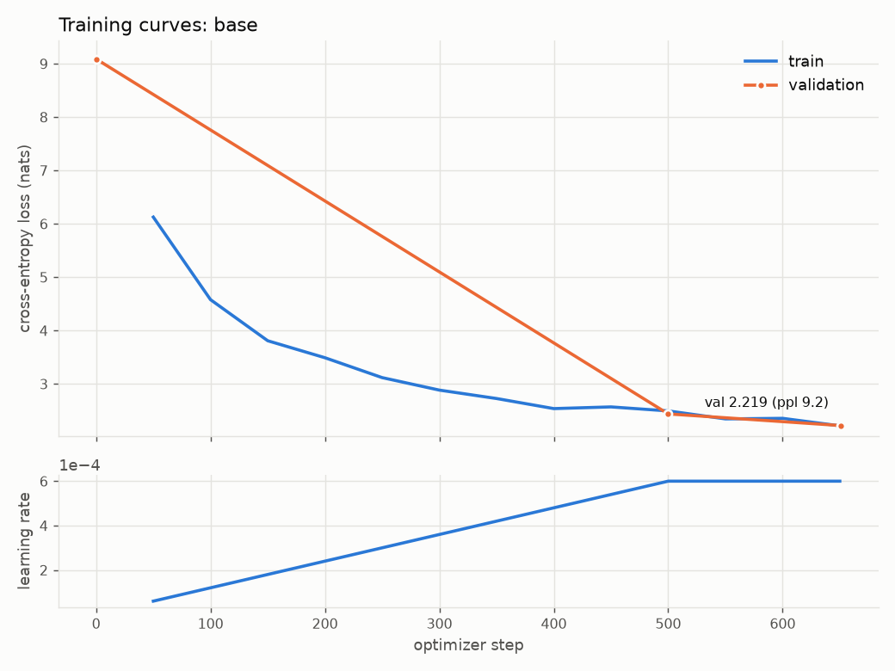

# tiny-llm — report (draft, started Day 6; to be finalised on PLAN Day 29)

A 29.4M-parameter GPT trained from scratch on a 700 MiB subset of TinyStories, on one
RTX 5050 Laptop GPU (8 GB) in three ~42-minute sessions. Everything (tokenizer, model,
training loop, sampling) is our own code on top of plain PyTorch.

## 1. Data and tokenizer
- TinyStories V2 (GPT-4) text, CDLA-Sharing-1.0: full validation file (27,630 stories) and the
  first 700 MiB of train (895,926 stories), cut at a story boundary.
- Own byte-level BPE (GPT-2 pre-tokenisation regex), vocab 8192: 256 bytes + 7,935 merges +
  `<|endoftext|>` (id 8191), trained on the first 200 MiB of train.
- 4.14 UTF-8 bytes per token; 176.7M train tokens and 5.4M val tokens, stored as uint16 memmaps.
- Checks: `scripts/check_tokenizer.py` (full-val round-trip, the .bin equals a fresh encoding,
  EOT count == story count) and `scripts/check_tokens.py` (file sizes vs meta, id range,
  random slices decode to readable text).

## 2. Model
| | |
|---|---|
| layers × d_model × heads | 8 × 512 × 8 (head dim 64) |
| context | 256 tokens |
| positions | RoPE (learned positions available as a switch) |
| block | pre-LayerNorm, causal self-attention (SDPA), GELU MLP 4×, residuals |
| embeddings | tied input/output |
| parameters | 29.4M |

Attention has two paths: a readable `manual` one (QKᵀ/√d, causal mask, softmax, ·V) and PyTorch SDPA
(`is_causal=True`, used for training). `scripts/check_attention.py` checks them against each other on the trained
model and real val text: the fp32 logits agree to 4.8e-5 and the val loss is identical (1.355887). Changing
tokens ≥ t leaves the logits < t bit-identical, the gradient of a logit w.r.t. later input embeddings is exactly 0,
and the KV-cache chunk path matches the full forward. SDPA trains at 70.7k vs 51.2k tok/s (uncompiled, batch 32)
and needs 3.0 vs 3.7 GB.

`scripts/check_model.py` checks the full-size model (both position types) on real val text: parameter count equals
the closed form (12d² + 4d per block, V·d tied embedding, 2d final LN, +T·d for learned positions = 29,377,536 for
RoPE, 29,508,608 learned); init stds are 0.02 (0.02/√16 for residual projections); the init loss is 9.07–9.08 against
ln 8192 = 9.011 (the extra ~0.07 is the logit variance 0.45²/2; the tied-embedding "self-token" logit is only +1.1–1.2
because the embedding is ~10% of the residual stream by the last layer); the residual-stream std grows smoothly
0.02 → 0.19 over 8 layers; causality holds bit-exactly; all parameters get finite non-zero grads; and 20 AdamW steps
on one batch take the loss from 9.07 to 5.29.

## 3. Training
bf16 autocast, AdamW (β = 0.9/0.95, weight decay 0.1 on matrices only), grad clip 1.0,
micro-batch 32 × grad-accum 2 × 256 tokens = 16,384 tokens/step, LR 6e-4 with 500 warmup steps
and cosine decay to 6e-5 at 40,000 steps (655M tokens ≈ 3.7 epochs of the subset).
`torch.compile` raised throughput from 66k to ~88.7k tok/s; peak VRAM 2.24 GB.
Checkpoints include the optimizer, RNG and data state, so resume is exact (tested).

| step | val loss | val ppl |
|---|---|---|
| 651 | 2.219 | 9.2 |
| 14,030 | 1.384 | 4.0 |
| 27,495 | 1.279 | 3.59 |
| 40,000 | 1.229 | 3.42 |

## 4. Samples
See `samples/suite_step40000.md` (6 prompts × 4 decoding settings, fixed seeds). 23/24 samples
end on their own with `<|endoftext|>`; repeated-4-gram fraction 0.010–0.049. Greedy example:

> Once upon a time, there was a little girl named Lily. She had a big, red ball that she loved to
> play with. One day, she went to the park with her mom and took her ball with her. […] After
> playing, Lily and Tim became good friends. They learned that sharing made them happy. The moral
> of the story is to always share with others and be kind.

## 5. What changed results
- **Positions**: RoPE beats learned positions, 1.557 vs 1.587 val loss at 49M tokens (section 5.1).
- **Learning rate**: at 49M tokens, 1.2e-3 > 6e-4 > 3e-4 (1.519 / 1.557 / 1.645). The batch-32k run at equal
  tokens is worse (1.624) (section 5.2).
- `torch.compile`: +31% throughput, the same loss (so more tokens per session).
- KV cache: identical greedy tokens, 1.6× faster at batch 1 and 9–22× at batch 8–32 (`kv_cache.md`).

### 5.1 Positions ablation
Same 8×512 model and 16k-token batch as the main run, 3000 steps (49.2M tokens) each with its own
warmup 300 + cosine schedule (`scripts/run_abl_pos.sh`, Day 6).

| positions | final val loss | val ppl | tok/s |
|---|---|---|---|
| RoPE | **1.557** | 4.75 | 86.6k* |
| learned | 1.587 | 4.89 | 90.1k |

RoPE is ahead at every eval. The gap is largest early (0.28 nats at step 250, 0.14 at 500) and narrows to
0.030 at the end, so RoPE mostly speeds up early learning. One seed per arm, so seed-to-seed spread is not
measured. But the gap is consistent across all 12 evals (same fixed 40 val windows). *RoPE's tok/s is lower partly because
CPU jobs ran alongside it; the extra rotation costs a few % at most.

### 5.2 LR / batch sweep
Equal 49.2M-token budget, 8×512 model, each run with its own warmup + cosine (to lr/10)
(`scripts/run_sweep.sh`, Day 6). The baseline is the positions-ablation RoPE run.

| run | lr | tokens/step | steps | final val loss | ppl |
|---|---|---|---|---|---|
| baseline | 6e-4 | 16k | 3000 | 1.557 | 4.75 |
| lr3e-4 | 3e-4 | 16k | 3000 | 1.645 | 5.18 |
| lr1.2e-3 | 1.2e-3 | 16k | 3000 | **1.519** | 4.57 |
| bs32k | 6e-4 | 32k | 1500 | 1.624 | 5.07 |

- At this short budget, a higher LR is better: going 3e-4 → 6e-4 → 1.2e-3 gives 1.645 → 1.557 → 1.519. It is
  still improving at 1.2e-3, and training stayed stable (val fell at every eval; grad norm ≤ 0.53 after step 500), so the best LR is ≥ 1.2e-3.
- Doubling the batch at the same LR and token count is worse (1.624 vs 1.557): half as many optimizer steps.
  It would likely need a higher LR to catch up. With 49M tokens we are well below the critical batch size.
- Caveat: these are 3000-step runs. The main run (40k steps, lr 6e-4) might also have gained from a higher
  LR, but that wasn't tested at full length. One seed per run.

### 5.3 Instruction fine-tune (PLAN Day 27)
Prompts are made from our own stories ("uses the words …" / "begins with …"), and the loss is on the
story only. Measured with `scripts/eval_instruct.py` on 200 held-out prompts (T=0.8, top-p 0.95):

| model | follows prompt |
|---|---|
| base (step 40,000) | 0.0% (`instruct_eval_base.md`) |
| fine-tuned v1 (33k rows, 1000 steps ≈ 2 epochs, lr 1e-4) | 16.5% overall: "begins with" 88.6%, "uses the words" 1.2% (`instruct_eval_ft.md`) |
| fine-tuned v2 (132k rows, 2000 steps ≈ 1 epoch, lr 5e-5) | 15.0% overall: "begins with" 82.9%, "uses the words" 0.6% (`instruct_eval_ft_v2.md`) |

Partial credit on "uses the words" prompts (share of requested words that appear): base 4.8%, v1 23.6%, v2 22.8%.

The fine-tuned model reliably writes a story after `Story:` and copies a given opening sentence. It
rarely uses three requested words: it tends to write a typical story and ignore them. Val loss (story
tokens of held-out rows) fell from 1.227 to 1.103 by step 100, then rose slightly to 1.118 at step 1000,
while train loss fell to 0.92. One epoch is 516 steps, so the rise starts inside the first epoch. The
quick gain is the prompt format, and after that the model fits these 33k stories. Next to try: a few
times more rows at ≤ 1 epoch and fewer steps, and judging "uses the words" by partial credit too.

v2 tried exactly that: 4× the rows, about 1 epoch, half the LR. Val loss improved (1.082 vs 1.103 at best,
still falling at the end), but prompt-following did not; the differences from v1 are within sampling noise on
200 prompts. `scripts/prompt_sensitivity.py` shows why. It scores each held-out story after its own prompt
and after another row's prompt (story loss, nats/token, 200 rows per kind):

| model | "words": swapped − own | "begins": swapped − own |
|---|---|---|
| base | +0.001 | +0.061 |
| v1 | +0.010 | +0.210 |
| v2 | +0.010 | +0.215 |

The fine-tuned models use a given first sentence heavily, but barely use the word list: wrong words cost
only 0.01 nats/token. Lower story loss came from better story modelling, not from reading the
prompt. With 3 random content words per ~200-token story, the words contribute little to the loss, so
there is little gradient pushing the model to attend to them. Ideas for the next pass: up-weight the
loss on the requested-word tokens, use fewer, more salient words (nouns that occur more than once), or
start with 1-word prompts and build up to 3.

**v3 (salient words) and a prompt bug.** While building v3 I found a bug in the word picker: the regex
`[a-z]{4,}` also matched the lowercase tail of capitalised words ("Suddenly" → "uddenly", "Tommy" → "ommy"),
so about 9% of the v1/v2 "words" prompts asked for a fragment no story contains. That caps the follow rate.
Fixed with word boundaries, plus a regression test that every words prompt is satisfiable by its own story;
274 of the 818 held-out prompts change. v3 = 132k rows where the 3 words are drawn from the story's
**salient** words (content words occurring ≥ 2×, i.e. characters/objects/places), same recipe as v2
(`configs/instruct_v3.json`, lr 5e-5, 2000 steps, 6.5 min). Val loss 1.072 (v2 1.082, not comparable: different rows).

| eval prompts (200 held-out) | model | follows | begins | words | words partial |
|---|---|---|---|---|---|
| fixed "any" words (`data/instruct_anyfix`) | v2 | 15.0% | 82.9% | 0.6% | 22.8% |
| | v3 | 16.5% | 82.9% | 2.4% | 30.9% |
| salient words (`data/instruct_v3`) | v2 | 18.5% | 87.2% | 1.9% | 27.1% |
| | v3 | 20.0% | 89.7% | 3.1% | 36.9% |

Prompt sensitivity ("words" gap, swapped − own, nats/token): on the old prompts v2 +0.010 → v3 +0.017; on
salient prompts v2 +0.015 → v3 +0.033. "Begins" gaps are unchanged (~+0.21). So salient words roughly double
the model's use of the word list and raise partial credit by 8–10 points, but using all three words is still
rare (~3%). The word list is still a weak signal next to the story-modelling loss; the remaining lever is to
up-weight the loss on the requested-word tokens (or 1-word prompts first). Files: `instruct_eval_v{2,3}_on_{anyfix,v3}.md`.

**v4 (up-weighted word tokens).** Same 132k rows and recipe as v3; only the loss changes. `scripts/mark_words.py`
marks every target token that is part of a whole-word, case-insensitive occurrence of a requested word (4.0% of
target tokens; every words row has at least one mark). Those positions get weight 5, everything else 1, and the
loss is the weighted mean over the story targets (`train.train_mask_file`, `train.mask_loss_weight`). The marked tokens
are then ~17% of the loss mass instead of 4%. Unweighted val loss 1.082 (v3 1.072): it costs a little story modelling.

| eval prompts (200 held-out) | model | follows | begins | words | words partial |
|---|---|---|---|---|---|
| fixed "any" words | v3 | 16.5% | 82.9% | 2.4% | 30.9% |
| | **v4** | **25.0%** | 88.6% | 11.5% | 52.3% |
| salient words | v3 | 20.0% | 89.7% | 3.1% | 36.9% |
| | **v4** | **39.0%** | 87.2% | 27.3% | 62.7% |

Words sensitivity gap: salient +0.033 → +0.063, fixed-any +0.017 → +0.039 nats/token; begins unchanged (~+0.20–0.21).
This is the largest single gain of the fine-tune work: the model wasn't failing to *understand* the list, the
signal was just drowned out by ~200 other story tokens per row. Stories still end with EOT (192–196/200) and repetition
is unchanged (rep4 0.022). Files: `instruct_eval_v4_on_{anyfix,v3}.md`.

## 6. Limitations and what's next
- The 256-token context covers most stories; longer generations use a rebuilt cache window.
- Only a 700 MiB subset was used (disk limit), so the main run saw each story ~3.7 times.
