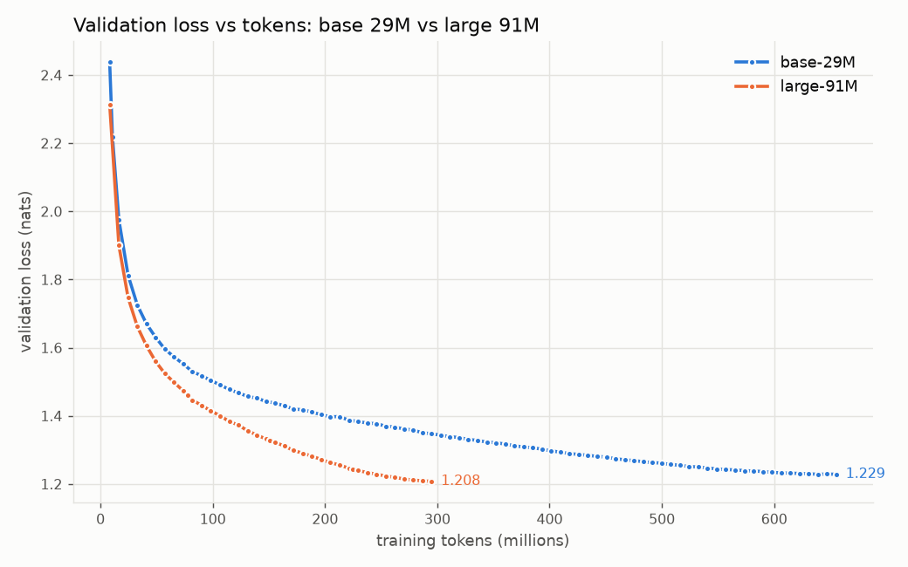

# Large (91M) vs base (29M) — Day 20 comparison (done on Day 18, 2026-11-09)

Both models: same tokenizer (8192 BPE), RoPE, block 256, 16,384 tokens/step, cosine LR, bf16.
Base: 8×512, 40,000 steps (655M tokens). Large: 12×768, 18,000 steps (295M tokens).



## Final checkpoints on identical windows (`scripts/eval_ppl.py`)

```
.venv/bin/python scripts/eval_ppl.py ckpt/base ckpt/large --labels base-29M large-91M --iters 200 --out docs/large_vs_base_eval.md
```

Validation: 200 × 32 windows of 256 tokens (1,638,400 tokens, seed 1234), same windows for every model.

| model | params | step | val loss | ppl |
|---|---|---|---|---|
| base-29M | 29.4M | 40000 | 1.2410 | 3.459 |
| large-91M | 91.3M | 18000 | 1.2192 | 3.384 |

## At equal training tokens (training-time val, 40 fixed windows)

| tokens | base-29M | large-91M |
|---|---|---|
| 82M (step 5000) | 1.529 | 1.446 |
| 164M (step 10000) | 1.429 | 1.311 |
| 295M (step 18000) | 1.348 | 1.208 |

Curve table (`compare_runs.py --x tokens`): [large_vs_base_curves.md](large_vs_base_curves.md).

## Samples

Sample suites (6 prompts × 4 settings, seed 1234): base `samples/suite_step40000.md`, large `samples/large.md`.

| setting | base mean rep4 / distinct2 | large mean rep4 / distinct2 |
|---|---|---|
| greedy | 0.012 / 0.870 | 0.015 / 0.851 |
| T=0.7 top-k=40 | 0.049 / 0.820 | 0.019 / 0.865 |
| T=0.8 top-p=0.95 | 0.010 / 0.829 | 0.044 / 0.789 |
| T=1.0 top-p=0.9 | 0.020 / 0.833 | 0.024 / 0.853 |

## Takeaways
- At equal tokens the 91M model is 0.14 nats better (ppl 3.35 vs 3.85); with 2.2× fewer tokens it still beats
  the base model's final checkpoint (1.219 vs 1.241 on 1.6M held-out tokens).
- Cost: 2.8× slower training (31k vs 87k tok/s) and 4.96 GB vs 2.2 GB peak VRAM.
- Both models end every sample with `<|endoftext|>`; repetition stats are low for both and mixed (no clear winner per setting; 6 samples each is noisy) — at this
  scale the difference shows mostly in loss, less in the simple surface stats. Reading samples, both are fluent;
  the large model's stories are slightly more consistent (names, objects) but this is a qualitative impression.
- The large model is the base for the chat fine-tune (Days 21–22).
